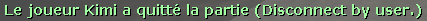
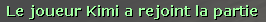
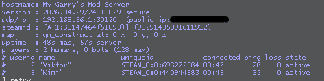
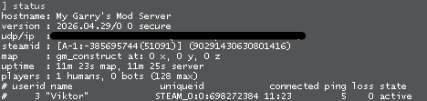
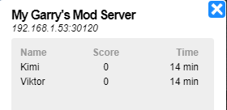
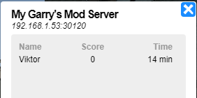
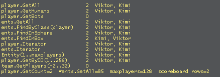
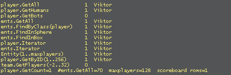

<p align="center">
  <picture>
    <source media="(prefers-color-scheme: dark)" srcset="docs/images/vanish-dark.svg">
    
  </picture>
</p>

<h1 align="center">vanish</h1>

<p align="center">
  <strong>Server-side player hiding for Garry's Mod servers</strong><br>
  <sub>CheckTransmit · delta headers · A2S · faked disconnect</sub>
</p>

<p align="center">
  <a href="https://github.com/ds-kimi/vanish/releases"></a>
  <a href="https://github.com/ds-kimi/vanish/actions/workflows/build.yml"></a>
  <a href="https://github.com/ds-kimi/vanish"></a>
  <a href="LICENSE"></a>
  
  
</p>

<br>

A whitelisted player runs `vanish` and drops out of the world, out of every
scoreboard, out of `status` and `ping`, out of server-side Lua, and out of A2S
query tools. Nothing ships to clients, so nothing depends on a client
cooperating.

---

## What it looks like

Kimi is the vanished player in every screenshot. Viktor is an ordinary player,
and everything below is what Viktor's client shows.

Vanishing sends the leave message the engine would send for a real disconnect,
and unvanishing sends the matching join:





`status`, typed by Viktor, before and after:

| Kimi visible | Kimi vanished |
|---|---|
|  |  |

The A2S player list that the server browser and every external query tool read:

| Kimi visible | Kimi vanished |
|---|---|
|  |  |

And every client-side way of reaching a player, run from Viktor's console:

| Kimi visible | Kimi vanished |
|---|---|
|  |  |

The entity count falls from 85 to 70 across the toggle: the player, their
weapons and everything else they own.

### Checking it yourself

Paste this into a client console to sweep every way a client can reach a
player. `*` marks a dormant entity, `!!` marks a player that some function
returned but `player.GetAll` did not.

<details>
<summary>lua_run_cl one-liner</summary>

```lua
lua_run_cl local base,o={},{} for _,p in ipairs(player.GetAll()) do base[p]=true end local function c(n,l) local t={} for _,e in pairs(l or {}) do if IsValid(e) and e:IsPlayer() then local k=e:Nick()..(e:IsDormant() and "*" or "") if not base[e] then k="!!"..k end t[#t+1]=k end end o[#o+1]=string.format("%-26s %2d  %s",n,#t,table.concat(t,", ")) end c("player.GetAll",player.GetAll()) c("player.GetHumans",player.GetHumans()) c("player.GetBots",player.GetBots()) c("ents.GetAll",ents.GetAll()) c("ents.FindByClass(player)",ents.FindByClass("player")) c("ents.FindInSphere",ents.FindInSphere(Vector(0,0,0),100000)) c("ents.FindInBox",ents.FindInBox(Vector(-16384,-16384,-16384),Vector(16384,16384,16384))) local a={} if player.Iterator then for _,p in player.Iterator() do a[#a+1]=p end end c("player.Iterator",a) local b={} if ents.Iterator then for _,e in ents.Iterator() do b[#b+1]=e end end c("ents.Iterator",b) local d={} for i=1,game.MaxPlayers()+2 do local e=Entity(i) if IsValid(e) and e:IsPlayer() then d[#d+1]=e end end c("Entity(1..maxplayers)",d) local f={} for i=1,256 do local p=player.GetByID(i) if IsValid(p) then f[#f+1]=p end end c("player.GetByID(1..256)",f) local g={} for id=-2,32 do for _,p in ipairs(team.GetPlayers(id) or {}) do g[#g+1]=p end end c("team.GetPlayers(-2..32)",g) o[#o+1]="player.GetCount="..player.GetCount().."  #ents.GetAll="..#ents.GetAll().."  maxplayers="..game.MaxPlayers().."  scoreboard rows="..#player.GetAll() MsgN("\n"..table.concat(o,"\n").."\n")
```

</details>

The `Entity(1..maxplayers)` row is the one that decides it. Every other
client-side function is built on the entity list, so if the raw index sweep is
clean, nothing else can leak. A dormant hit there means the entity survived as
a ghost with its name and SteamID intact, which is exactly what the
`SV_WriteDeltaHeader` detour exists to prevent.

## What it hides

| Surface | How |
|---|---|
| Player entity, weapons, children, ragdoll | `CheckTransmit` hook clears the transmit bit per receiving client |
| Scoreboards and client `player.GetAll()` | `SV_WriteDeltaHeader` detour turns the leave-PVS header into a delete |
| `status`, `ping`, `users`, `stats` | command dropped at the netchannel, answered with a filtered listing in the engine's own format |
| Server-side Lua | the roster, lookup, iterator, spatial search and team counter functions, listed below |
| A2S_INFO / A2S_PLAYER | `recvfrom` detour answers queries from the visible roster |
| Client leave notice, client-side addons | a real `player_disconnect` game event goes out, so every client runs its own disconnect path |
| Admin mod logs | the selected `PlayerDisconnected` handlers run for a player that never left, and the join handlers run on unvanish |
| Footsteps, weapon fire, physics, voice, chat | stopped at the hook that emits them, because sound and voice travel by position and name rather than by transmit state |
| Kill feed, damage logs, death events | damage they deal is blocked, suicide is blocked, and the attack buttons are stripped so no tracer or decal goes out |
| userinfo string table | optional, blanks the last copy of their name and SteamID left on every client |

Staff listed in `allowed` keep seeing vanished players, and a vanished player
always sees themselves.

## Warning about A2S spoofing

`hideFromQueries` makes the server answer A2S_INFO and A2S_PLAYER itself, with
the hidden player removed and the player count reduced. That is the same
mechanism player-count spoofers use, and Facepunch treats a server whose query
replies disagree with its real state as fraudulent. Servers doing this have
been delisted from the in-game server browser, and the ban lands on the server,
not on the addon.

The risk is yours to weigh. A private server nobody queries is a different
situation from a public one advertising on the master list. If you are not
prepared to be delisted, set `hideFromQueries = false` and accept that query
tools still see the vanished player. Every other surface stays hidden.

It ships enabled. If your server is public, decide deliberately whether to keep
it that way.

## Why a module is needed

`Entity:SetPreventTransmit` does not hide players. `CBasePlayer` edicts are
marked `FL_EDICT_ALWAYS`, and the engine writes them to every client's snapshot
regardless. Clearing the transmit bit after the engine's own pass fixes half of
it. The other half is that a per-client hide makes the client mark the entity
*dormant* rather than delete it, because the engine only sets `FHDR_DELETE`
when an entity leaves the **global** frame snapshot. A dormant entity keeps its
name and SteamID in the client's entity list, which is why it still turns up on
scoreboards. `gmsv_vanish` detours `SV_WriteDeltaHeader` and promotes the
header to a delete for hidden entities, per receiving client.

## Requirements

- Garry's Mod dedicated server, **Windows 32-bit (`win32`) only for now**.
  Linux and 64-bit builds are coming: the engine offsets the hooks rely on were
  verified against the x86 Windows engine, and each other platform needs its own
  check before it can be trusted.
- `gmsv_vanish`, this repository. Hides entities and answers A2S queries.
- [gm_sourcenet](https://github.com/danielga/gm_sourcenet), optional, needed to
  filter `status` and `ping`. It needs the compatibility patch in
  [`patches/`](patches) to load on current GMod builds; see
  [CONTRIBUTING.md](CONTRIBUTING.md).

Every feature degrades on its own. Without a module, the matching config option
does nothing and the rest keeps working; without the `sourcenet` Lua, the
command filter says so in the console and stops.

## Downloads

Every commit publishes a release with one archive per platform, currently
`vanish-win32.zip`. Each archive mirrors the `garrysmod` directory:

```
garrysmod/lua/bin/gmsv_vanish_win32.dll
garrysmod/lua/bin/gmsv_sourcenet_win32.dll
garrysmod/addons/vanish/lua/...
```

Extract it over your `garrysmod` folder, set `allowed` in the config, restart.
gm_sourcenet is built from its pinned upstream commit with the patch in
[`patches/`](patches) already applied.

## Building

```sh
git clone --recursive https://github.com/ds-kimi/vanish.git
cd vanish/module/projects
premake5 --gmcommon=../../dependencies/garrysmod_common vs2022   # or gmake
```

Build the generated project in **Release / Win32**, then copy
`gmsv_vanish_win32.dll` into `garrysmod/lua/bin/`.

That builds this repository's module only. `gmsv_sourcenet_win32.dll` has to
come from the release archive, or from your own build of the pinned commit with
the patch in [`patches/`](patches) applied. The CI workflow does exactly that,
see [.github/workflows/build.yml](.github/workflows/build.yml).

The Lua half of gm_sourcenet is vendored, patched, in
[`addon/lua/sourcenet/`](addon/lua/sourcenet), so a plain clone is installable.
CI fails the build if it drifts from the pinned upstream.

## Installing

1. Copy [`addon/`](addon) to `garrysmod/addons/vanish/`. The patched
   `sourcenet` Lua comes along with it.
2. Copy the module DLLs to `garrysmod/lua/bin/`.
3. Put your SteamID in `allowed` in
   [`addon/lua/vanish/sv_config.lua`](addon/lua/vanish/sv_config.lua).
4. Restart the server and run `vanish` in your console to toggle.

## Layout

```
addon/lua/
  sourcenet/                  vendored gm_sourcenet Lua, patched
  autorun/server/vanish.lua   loads everything in order
  vanish/sv_config.lua        every setting lives here
  vanish/core/                vanish state and the console command
  vanish/hiding/              entities, the Lua libraries, A2S queries,
                              sound, voice, chat, combat, userinfo
  vanish/fake/                the fake disconnect and vanished protections
  vanish/console/             status and ping replies, command filtering
```

## Configuration

Basic settings sit at the top of `vanish/sv_config.lua`:

```lua
allowed         -- SteamIDs that may toggle vanish, and that keep seeing others
hideEntities    -- hide the player entity          (needs gmsv_vanish)
filterCommands  -- filter status and ping          (needs gmsv_sourcenet)
hideFromQueries -- hide from A2S                   (needs gmsv_vanish)
fakeDisconnect  -- broadcast a fake player_disconnect     (needs gmsv_vanish)
protect         -- godmode, noclip, notarget, no collisions
persist         -- keep the vanish across a map change
hideUserinfo    -- blank the userinfo entry             (needs gmsv_vanish)
debug           -- server console tracing
```

Advanced settings follow in the same file: the blocked command list, the
transmit refresh interval, and the `status` header fields. By default the
synthesised `status` reports the server's real version, public address and
SteamID; set `status.spoof` to `true` to send fixed strings instead.

## Answering, not swallowing

Four commands enumerate players, and all four are dropped before the engine
sees them. A dropped command has to be answered, because silence is a tell of
its own: a client that types `users` and gets nothing back knows something ate
it. Each reply is rebuilt in the engine's own format, taken out of `engine.dll`
rather than guessed:

| Command | Format |
|---|---|
| `status` | the header block, then one row per visible player |
| `ping` | `Client ping times:` and `%4.0f ms : %s` |
| `users` | `<slot:userid:"name">`, `%i:%i:"%s"`, `%i users` |
| `stats` | the column header and one row, player count masked |

`stats` is the awkward one. Only its player count would give anything away, but
the engine prints the whole row at once, so the row is rebuilt: CPU, throughput
and map changes come from the engine through the module, uptime and frame rate
from Lua, and only the count is filtered. Connections since start are counted
by the addon, so that column resets on a map change while the engine's would
not.

The version line is the same class of problem. A dedicated server's `steam.inf`
carries `PatchVersion` and nothing else, so reading the protocol and build from
it printed `2026.04.29/0 0 secure` against the engine's real
`2026.04.29/24 10029 secure`. The version string changed the moment somebody
vanished. The build now comes from `IVEngineServer::GetServerVersion`, with
`status.protocol` and `status.build` in the config as a last resort.

## Faking the disconnect

Hiding the entity removes a player from the world, but a client that loses an
entity says nothing about it. `fakeDisconnect` broadcasts the engine's own
`player_disconnect` event, which is what makes the client print "Name has left
the game (reason)", drop the player from its own tracking, and run every
client-side addon listening for that event. Lua cannot raise a game event, so
the module exposes `vanishevent.Fire(name, fields)` for it.

Server side, `disconnect.hooks` selects which `PlayerDisconnected` handlers
run, so ULX, SAM and similar log the departure:

- `"none"`, nothing runs and only clients are told.
- `"match"`, the default: handlers whose identifier contains one of
  `disconnect.hookPatterns`, by default `ulx`, `ulib` and `log`. That reaches
  the logging handlers, ULX's and DarkRP's FAdmin among them, and nothing that
  changes player state.
- `"all"`, every handler, gamemode logic included. DarkRP sells doors, drops
  money and saves the player's data on disconnect, and none of that is undone
  when the player unvanishes. Opt in deliberately.

Unvanishing broadcasts `player_connect`, so coming back reads as a rejoin. Set
`disconnect.announceRejoin` to `false` to return silently.

Every client is told, staff included. The engine has no way to send a game
event to a chosen subset of clients, so an allowed viewer sees the leave
message even though the player stays visible to them.

## Protection

`protect` gives a vanished player godmode, noclip, notarget and pass-through
collisions, restored on unvanish from the state captured when they vanished.
All four are engine level and reachable from Lua: `GodEnable` sets
`FL_GODMODE`, `SetMoveType` writes `MOVETYPE_NOCLIP`. No module is involved.
`EntityTakeDamage` also blocks code that damages players without consulting
`FL_GODMODE`. Individual pieces toggle under `Vanish.Config.protection`.

## What server-side Lua sees

Every function that can reach a player without listing the roster is masked,
because filtering only the list functions leaves each of these wide open:

| Library | Masked |
|---|---|
| `player` | `GetAll`, `GetHumans`, `GetCount`, `Iterator`, `GetBySteamID`, `GetBySteamID64`, `GetByAccountID`, `GetByUniqueID`, `GetByID` |
| `ents` | `GetAll`, `Iterator`, `FindByClass`, `FindByModel`, `FindByName`, `FindInSphere`, `FindInBox`, `FindInCone`, `FindAlongRay` |
| `team` | `GetPlayers`, `NumPlayers`, `TotalFrags`, `TotalDeaths` |

`player.Iterator` and `ents.Iterator` matter most. They are what addons written
since 2023 use instead of `GetAll`, and an unfiltered iterator hands out every
vanished player no matter how well the list functions are masked. The team
counters matter for the same reason in reverse: a team whose list is one
shorter but whose count is not tells any addon comparing them that somebody is
hidden.

## Silence

A hidden entity is still an audible one. Sounds travel by position, not by the
transmit state of the entity that made them, so `Vanish.Config.silence` stops
them at the hook that emits them:

| Setting | Stops |
|---|---|
| `sounds` | footsteps, weapon fire, physics impacts, anything the player or their weapons emit |
| `voice` | voice chat, staff still hear a vanished player |
| `chat` | chat messages, echoed to staff and the speaker instead |
| `blockOutgoingDamage` | damage they deal, which is what the kill feed and damage logs react to |
| `blockSuicide` | a death that would broadcast an event and drop a named ragdoll |
| `blockAttacks` | the attack buttons, since firing sends tracers and decals to everyone in range whether the damage lands or not. Set `false` to keep the physgun and toolgun usable |

## Persistence

`persist` writes the vanish set to `data/vanish_state.txt` and restores it at
`PlayerAuthed`, before the first spawn, so the player is hidden without ever
having been transmitted. A restore is silent: announcing a departure for a
player nobody has seen yet would invent one. A real disconnect while vanished
carries the state forward too, since leaving is not a decision to be visible.

## Limitations

- `hideUserinfo` blanks the string table entry for everybody, the vanished
  player included, so their own client draws a blank name in any HUD reading
  `LocalPlayer():Nick()`. Off by default for that reason.
- Every client is told about the fake disconnect, staff included: the engine
  cannot send a game event to a subset of clients.
- Doors opening, props moving and buttons being pressed still happen, and props
  spawned while vanished stay visible.
- The server console and RCON see the real state. Filtering there was left out
  deliberately: it hides nothing from players, only from co-owners.
- Addons that cache the player list at join time instead of calling
  `player.GetAll()` will still hold a reference.

## License

BSD 3-Clause. See [LICENSE](LICENSE).

The A2S query filtering under `module/source/query/` is derived from
[gmsv_spoof](https://github.com/OmarAssadi/gmsv_spoof), itself derived from
gmsv_serversecure by Daniel Almeida, BSD 3-Clause: see
[`licenses/gmsv_spoof.txt`](licenses/gmsv_spoof.txt).

`garrysmod_common` and gm_sourcenet are the property of their respective
authors and carry their own licenses.

---

## Star history

<a href="https://www.star-history.com/#ds-kimi/vanish&amp;Date"></a>

See the interactive chart on **[Star History](https://www.star-history.com/)** (repo: `ds-kimi/vanish`).
